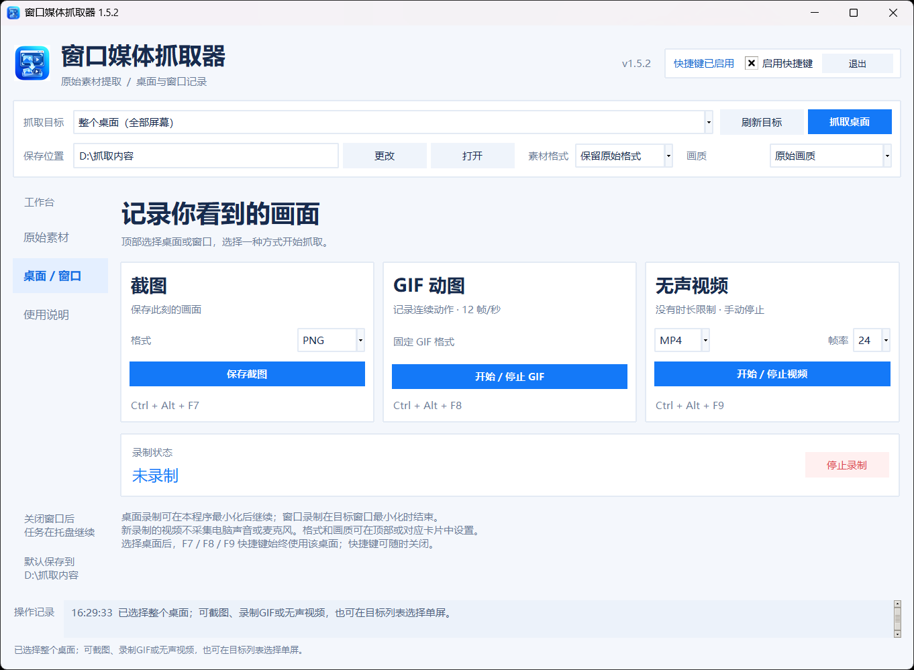

# 窗口媒体抓取器

Windows 桌面工具：提取网页和启动器缓存中的图片、GIF、视频，也可以截图和录制桌面或窗口。中文界面，无需安装 Python。

**[下载 Windows x64 便携版](https://github.com/senhao730-arch/window-media-grabber/releases/latest)** · [版本记录](https://github.com/senhao730-arch/window-media-grabber/releases) · [反馈问题](https://github.com/senhao730-arch/window-media-grabber/issues)

## 下载与运行

1. 打开上方下载链接，在 Assets 中下载 `window-media-grabber-v1.5-windows-x64.zip`。
2. 解压后双击 `窗口媒体抓取器.exe`。首次启动可能需要几秒。
3. 顶部选择抓取目标和保存位置。默认保存到 `D:\抓取内容`；没有 D 盘时请更改为存在且可写的目录。



## 功能

- **原始素材**：使用独立 Edge 浏览器分析网页图片、GIF 和视频，支持部分 HLS 视频无声合并；扫描启动器缓存和可识别的媒体目录，预览候选素材并保存。
- **启动器目录**：支持米哈游启动器缓存、三角洲行动启动器常见媒体目录，支持手动选择素材目录并按软件记忆。
- **桌面与窗口**：整个桌面、单块显示器或指定窗口；PNG/JPEG/WebP 截图、GIF 动图、MP4/WebM/MKV 无声视频；可选择画质、视频帧率。
- **完整性检查**：验证缓存分段覆盖范围；提取视频保存前、转换后进行全程解码校验，拒绝已识别的截断或损坏文件。
- **快捷键**：可随时启用或关闭。支持取消扫描、下载和校验，手动停止录制。

| 快捷键 | 操作 |
| --- | --- |
| Ctrl + Alt + F6 | 选中前台软件并扫描缓存 |
| Ctrl + Alt + F7 | 截图 |
| Ctrl + Alt + F8 | 开始 / 停止 GIF |
| Ctrl + Alt + F9 | 开始 / 停止视频 |

选择桌面后，F7/F8/F9 的快捷键继续操作该桌面，不会切换到前台软件。

## 支持范围与使用建议

缓存候选可能包含历史页面资源，不能保证只识别当前页面。微信加密资源、游戏资源包、DRM 受保护媒体暂不支持通用提取。资源未识别不代表一定加密。

原始缓存提取不依赖窗口是否最小化；窗口录制在目标窗口最小化时结束。桌面录制可在本程序最小化后继续，但记录的是屏幕实际显示内容。

缓存扫描只读源文件，复制到程序暂存目录；不注入游戏、不读取游戏运行内存、不修改游戏文件。程序没有游戏方的安全认证，不能保证不存在反作弊误判或账号处罚风险。建议退出游戏客户端后扫描启动器素材，进入游戏前退出本工具，遵守对应平台规则。

独立 Edge 的网页下载功能可能使用该浏览器登录会话完成媒体请求。请只保存有权使用的内容。报告问题时不要上传 Cookie、登录资料或私人聊天内容。

## 源码运行与构建

需要 Windows x64、Python 3.12 或更高版本。

```powershell
python -m venv .venv
.\.venv\Scripts\python.exe -m pip install -r requirements.txt
.\.venv\Scripts\python.exe main.py
```

运行 `build.ps1` 生成 `dist/窗口媒体抓取器_修复版.exe`。需要网络下载依赖，EXE 包含 FFmpeg 和窗口捕获运行组件。

运行验证：

```powershell
.\.venv\Scripts\python.exe -m unittest discover -s . -p 'test_*.py' -v
```

部分测试会打开本地测试用 Edge、程序自身窗口或抓取桌面，需要交互式 Windows 桌面。没有米哈游缓存或外部截断视频样本时，对应测试跳过。本机仅实测单显示器，多屏功能未完成实际硬件验证。

## v1.5

蓝白界面、左侧导航、素材列表与预览、独立截图/GIF/视频操作卡片；紧凑窗口布局；新的程序图标。

应用源代码采用 MIT 许可，见 [LICENSE](LICENSE)。第三方组件遵守各自许可，见 [THIRD_PARTY_NOTICES.txt](THIRD_PARTY_NOTICES.txt) 和 [第三方许可归档](third_party_licenses.zip)。图标为用户提供的素材。
